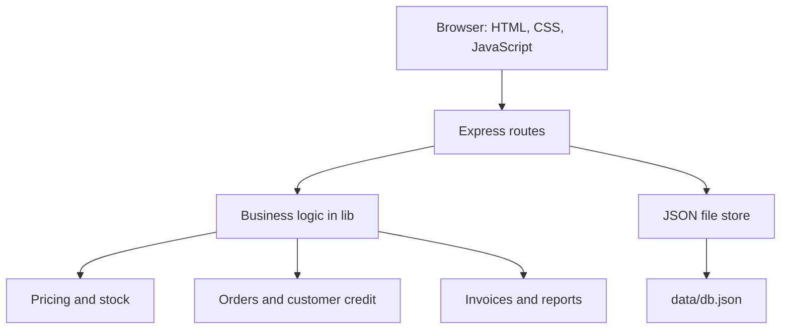

# ShopLedger onboarding

Reviewed on **November 21, 2026** against local `main` at `68c85a9`.

## Quick summary

- **ShopLedger is a small shop's billing application:** sales, inventory, customer credit, and printable invoices.
- **It runs as one Node.js/Express application**, with plain JavaScript in the browser.
- **Its entire database is one JSON file:** `data/db.json`.
- **Most development happened in 2021.** The available history then jumps to a GST fix dated November 15, 2026.
- **That fix is on remote-tracking branches, not the checked-out `main`.**
- **Confirmed problems include:** invoice discrepancies, cancellation failing to restore stock, incorrect settlement arithmetic, and broken date comparisons.
- This document describes the reviewed checkout; it does not establish what is deployed in production.

## Evidence labels

- **Confirmed:** directly supported by source code, Git diffs, or calculations run in memory.
- **Suspected:** a plausible explanation that the repository cannot prove.
- **Unknown:** requires team knowledge, deployment access, or other records.

## 1. What this project does

**Confirmed:** ShopLedger supports a kirana and wholesale business configured as “Corner Shop Kirana & Wholesale” in Pune.

Its four main screens are:

- **New Order:** select products, customer, payment mode, status, and coupon.
- **Order History:** search orders, filter them, cancel them, and open invoices.
- **Customer Khata:** view credit balances and record customer payments.
- **Inventory & GST Audit:** inspect stock and compare invoices with stored order totals.

### Useful vocabulary

- **POS:** point of sale—the billing screen.
- **Khata:** a customer's credit account.
- **SKU:** a product's internal stock identifier.
- **HSN:** the product classification used here to select a GST rate.
- **Settlement:** a payment against a customer's outstanding credit balance.

### Payment behavior

- **Confirmed:** Cash and UPI are recorded as payment labels.
- There is no payment gateway integration in this repository.
- Choosing UPI does not verify that money arrived.

## 2. The architecture



- The browser handles the interface and sends JSON requests.
- Express routes coordinate each operation.
- `lib/` contains the business rules.
- `store.js` reads and rewrites the database file.
- Invoice HTML is generated on the server.
- **Confirmed:** The tracked repository has no frontend framework, ORM, SQL database, build pipeline, or background worker.

## 3. Repository map: entry points

### [package.json](package.json)

- Declares the application as `shopledger`, version `0.8.4`.
- Lists Express and `body-parser` as direct dependencies.
- Starts the application with `npm start`.
- On reviewed `main`, `npm test` is a placeholder that intentionally fails.
- Does not declare a required Node.js version.

### [server.js](server.js)

- Creates the Express application.
- Enables JSON request parsing.
- Serves browser files from `public/`.
- Mounts all four route modules under `/api`.
- Serves printable invoices at `/orders/:id/invoice`.
- Listens on the configured port when launched directly.
- Exports the Express app when imported.

### [config.js](config.js)

- Defaults the port to `3000`, with a `PORT` environment override.
- Contains shop details, GST mapping, and the fallback tax rate.
- Contains inventory defaults and coupon definitions.
- Contains a hardcoded administrator export key.
- **Watch out:** `allowBackorder` is defined but unused.
- **Watch out:** A comment mentions `/api/admin/reset`, but no reset route is implemented.

## 4. Repository map: browser files

### [public/index.html](public/index.html)

- Defines the four screens and their form fields.
- Contains the dashboard cards.
- Loads the stylesheet and browser script.
- Uses HTML element IDs that `app.js` relies on.

### [public/js/app.js](public/js/app.js)

- Holds the current cart in a global `cartQuantities` object.
- Loads products, customers, dashboard figures, and reconciliation results.
- Uses `XMLHttpRequest` for GET and POST requests.
- Builds tables using HTML strings.
- Calls the pricing preview endpoint as quantities or coupons change.
- Sends order, cancellation, and settlement requests.
- Switches screens without loading separate pages.
- **Confirmed:** The cart is browser memory only; refreshing loses it.

### [public/css/style.css](public/css/style.css)

- Styles navigation, tables, stock indicators, billing drawer, and dashboard.
- Includes a layout adjustment for narrower screens.
- Invoice styling lives separately inside `lib/invoice.js`.

## 5. Repository map: API routes

Each route module reads data and delegates business rules to `lib/`.

| Module | Endpoint | Purpose |
| --- | --- | --- |
| [routes/products.js](routes/products.js) | `GET /api/products` | Products, stock availability, GST rates, optional search/category filters |
| Same module | `GET /api/coupons` | Active coupon definitions |
| [routes/orders.js](routes/orders.js) | `GET /api/orders` | Search and filter orders |
| Same module | `GET /api/orders/:id` | Retrieve one order |
| Same module | `POST /api/orders` | Place an order |
| Same module | `POST /api/orders/:id/cancel` | Cancel an order |
| [routes/customers.js](routes/customers.js) | `GET /api/customers` | Customer balances and recent settlements |
| Same module | `POST /api/customers/:id/settle` | Record a customer payment |
| [routes/reports.js](routes/reports.js) | `GET /api/reports/dashboard` | Dashboard totals and recent audit events |
| Same module | `GET /api/reports/gst-reconciliation` | Invoice versus stored-order comparison |
| Same module | `POST /api/pricing/preview` | Calculate cart totals without saving |
| Same module | `GET /api/admin/export` | Export the database when the key matches |

## 6. Repository map: business logic

### [lib/pricing.js](lib/pricing.js)

- Calculates subtotal and coupon discount.
- Distributes the discount proportionally across cart lines.
- Calculates GST on each discounted line.
- Returns totals, CGST/SGST, and line breakdowns.
- Rounds monetary calculations to two decimal places.

### [lib/coupons.js](lib/coupons.js)

- Trims and uppercases coupon codes.
- Checks existence, activation, and minimum order amount.
- Calculates percentage or flat discounts.
- Applies percentage discount caps.
- Reads definitions from `config.js`.

### [lib/tax.js](lib/tax.js)

- Prefers an explicit numeric `gstRate` when supplied.
- Otherwise looks up the item's HSN in configuration.
- Falls back to 18%.
- Splits GST into CGST and SGST.
- **Watch out:** HSN lookup uses an exact key match, although the configuration comment calls it a prefix mapping.

### [lib/inventory.js](lib/inventory.js)

- Finds products by ID.
- Calculates sellable stock as `max(0, stock - reserved)`.
- Checks requested quantities against availability.
- Deducts physical stock when an order is placed.
- Contains the release helper used by cancellation.
- Calculates stock counts and valuation.

### [lib/orders.js](lib/orders.js)

- Assigns order IDs and dates.
- Appends orders to the database object.
- Retrieves individual orders.
- Cancels orders and reverses Khata charges.
- Searches, filters, and sorts order history.

### [lib/ledger.js](lib/ledger.js)

- Finds customer accounts and calculates balances.
- Checks credit limits before charging a Khata order.
- Reverses charges when an order is cancelled.
- Records settlements.

```text
Balance due = opening balance + total billed - total settled
```

### [lib/invoice.js](lib/invoice.js)

- Independently calculates invoice figures on reviewed `main`.
- Builds a complete printable HTML page.
- Shows a warning when the invoice total differs from the stored order total.
- Escapes text fields used in the invoice.
- **The independent calculation is the main source of the GST discrepancy.**

### [lib/reports.js](lib/reports.js)

- Aggregates order revenue, tax, discounts, and status counts.
- Adds customer receivables and inventory figures.
- Compares stored totals with recalculated invoice figures.
- Excludes cancelled orders from revenue and reconciliation.
- Includes pending orders in revenue.
- Dashboard “revenue” represents non-cancelled order value, including credit sales and pending orders.
- It does not establish how much cash has been collected.

### [lib/dates.js](lib/dates.js)

- Generates `DD/MM/YYYY` dates using the server's local clock.
- Converts date-picker input into that format.
- Contains a fiscal-year helper with no callers in this repository.

### [lib/store.js](lib/store.js)

- Reads the entire JSON file synchronously.
- Adds missing top-level collections and counters in memory.
- Rewrites the entire file synchronously.
- Prepends audit events.
- Keeps only the latest 100 audit events.

## 7. Repository map: data and housekeeping

### [data/db.json](data/db.json)

**Confirmed:** The reviewed snapshot contains:

- 12 products.
- 5 customers.
- 8 orders.
- 4 settlements.
- Order and settlement ID counters.
- An audit log.
- Orders dated December 2021 through March 2022.

Each order stores:

- Customer and payment details.
- Status and date.
- A snapshot of product identity, name, SKU, price, HSN, and quantity.
- Coupon code.
- Subtotal, discount, tax, and final total.

**Important:** Detailed pricing breakdowns are calculated but not saved with the order.

- The applied GST rate is not explicitly captured by the order creation route.
- Later recalculation depends partly on current configuration.

### [.gitignore](.gitignore)

- Ignores `node_modules/`.
- Ignores `.DS_Store`.
- Ignores backup files and certain temporary database files.

### Existing local lockfile

- `package-lock.json` existed locally before this review.
- It was untracked and was left untouched.
- It is not part of reviewed `main`.

### Documentation and tooling at the time of review

- Before this onboarding document, reviewed `main` had no tracked README or onboarding guide.
- Reviewed `main` has no tracked tests, deployment configuration, or CI workflow.
- Tests exist on the 2026 fix branches described below.

## 8. What happened in Git

### 2021: the application grew in stages

| Date | Commit | Author | Change visible in the diff |
| --- | --- | --- | --- |
| March 8, 2021 | `93a89c3` | Rohit | Configuration, JSON storage, dates, package setup |
| March 19, 2021 | `3a5cdfc` | Rohit | Product data, inventory checks, coupons, flat GST pricing |
| March 29, 2021 | `c3605f1` | Rohit | Express server and product/order endpoints |
| April 14, 2021 | `f6c7d17` | Rohit | Browser interface and stylesheet |
| June 15, 2021 | `a0a6fa0` | Vikram | Reserved-stock calculation, safety buffer, release helper |
| July 22, 2021 | `cfc7803` | Vikram | HSN-based GST, coupon validation/caps, discounted-line taxation |
| August 23, 2021 | `49e3bc0` | Rohit | Customer credit ledger and cancellation |
| October 8, 2021 | `242e9ed` | Vikram | Reports routes, dashboard work, date utilities |
| November 17, 2021 | `68c85a9` | Neha | Printable invoice and invoice reconciliation |

### 2022–2025: no commits in the available history

- **Confirmed:** No commits dated in these years appear in the available branches.
- **Unknown:** Whether the application continued running or changed elsewhere.
- **Unknown:** Whether work exists in another repository or unavailable branches.
- No commit activity does not prove no business activity.

### November 2026: a targeted GST fix

Commit `e176abc`, authored by Sampurn Rattan on November 15, 2026:

- Replaces independent invoice arithmetic with `pricing.computeTotals()`.
- Adds `tests/characterization.js` to check existing pricing, tax, stock-buffer, and cancellation behavior.
- Adds `tests/invoice.test.js` to check invoice consistency, rendering, and reconciliation.
- Updates `npm test` to run those tests.

Branch state observed during review:

- Local `main` remains at the November 2021 commit, `68c85a9`.
- `origin/main` and `upstream/main` point to that same commit.
- Both remotes' `fix/gst-fix` and `fix/fix-gst2` tracking branches point to `e176abc`.
- The fix is **not part of the reviewed checkout**.

### A caution about the historical story

**Confirmed:** Some history details do not align neatly with the feature timeline.

- The March 2021 data commit already contains orders dated in 2022.
- The April interface already references features whose implementations appear in later commits.
- The initial commit message says “orders api,” but the actual routes arrive later.

**Suspected:** This may be a prepared workshop history or a reconstructed project timeline.

**Unknown:** Whether these dates represent real production milestones.

- The review used locally available history and remote-tracking references.
- The repository is not a shallow clone.
- No remote fetch was performed.

## 9. Placing an order: the complete path

### Step 1 — Load the billing screen

Entry point: initial boot calls in `public/js/app.js`.

- The browser requests products, customers, dashboard figures, and GST reconciliation.
- Products include server-calculated sellable stock and GST percentages.

### Step 2 — Select quantities

Entry points: `stepQty()`, `onQtyInput()`, and `getSelectedCartItems()` in `public/js/app.js`.

- Quantity controls update `cartQuantities`.
- `getSelectedCartItems()` builds the selected line items.
- Each selected product appears once in the normal browser flow.

### Step 3 — Preview the price

Entry points: `updateCartPreview()` and `POST /api/pricing/preview`.

- The browser posts items and coupon to the preview endpoint.
- The server retrieves prices and HSN values from its own database.
- It validates the coupon and calls `pricing.computeTotals()`.
- It returns totals without saving anything.
- **Important:** Preview does not reserve stock or check customer credit.
- A preview can succeed while the eventual order fails.

### Step 4 — Click “Place Order”

Entry point: the `place` button handler in `public/js/app.js`.

- The browser rejects an empty cart.
- It builds the customer, items, payment mode, status, and coupon payload.
- It posts that payload to `/api/orders`.

### Step 5 — Read the database

Entry point: `POST /orders` in `routes/orders.js`, mounted under `/api`.

- `store.read()` parses the JSON file into a fresh in-memory object.
- Missing or empty items produce HTTP `400`.

### Step 6 — Resolve each product

- The route looks up each submitted product ID.
- Unknown products produce HTTP `400`.
- The server copies the database's price, name, SKU, and HSN.
- Browser-supplied prices are not trusted.
- Quantities are parsed as integers.
- Invalid, zero, or negative quantities become `1`.
- Fractional quantities are truncated.

### Step 7 — Check stock

Entry point: `inventory.check()` in `lib/inventory.js`.

- Sellable stock is physical stock minus reserved stock, clamped to zero.
- Requests with `qty >= sellable` are rejected.
- Failure produces HTTP `409`.

Example with 10 physical units and 2 reserved:

- The UI reports 8 sellable.
- Ordering 7 succeeds.
- Ordering 8 fails.

### Step 8 — Validate the coupon

- The route trims and uppercases the code.
- Validation checks existence, activation, and minimum subtotal.
- An invalid coupon produces HTTP `400`.
- **Difference from preview:** Preview shows totals without an invalid coupon; order creation rejects it.

### Step 9 — Calculate the final amount

Entry point: `pricing.computeTotals()` in `lib/pricing.js`.

- Sum `price × quantity`.
- Calculate the coupon discount.
- Allocate the discount proportionally across lines.
- Calculate GST on each discounted line.
- Sum the rounded tax amounts.
- Add tax to the discounted subtotal.

```text
Final total = subtotal - discount + GST
```

### Step 10 — Resolve the customer and credit

- Customer defaults to `Walk-in`.
- A recognized customer ID overrides the submitted name.
- Payment mode defaults to `cash`.

For Khata orders:

- A registered customer is required.
- The ledger checks projected balance against the credit limit.
- A missing account or exceeded limit prevents the order.
- A successful charge increases `totalBilled` in memory.

### Step 11 — Deduct stock

Entry point: `inventory.reserve()` in `lib/inventory.js`.

- It subtracts quantity from physical `stock`.
- Despite its name, it does not increase `reserved`.
- Pending orders deduct stock immediately too.

### Step 12 — Create the order

Entry point: `orders.add()` in `lib/orders.js`.

- Assign the next order ID.
- Increment the counter.
- Generate today's date.
- Save line-item snapshots and totals.
- Append the order to `db.orders`.
- Default the status to `completed`.

### Step 13 — Persist everything

Entry points: `store.appendAudit()` and `store.write()`.

- Add an `ORDER_CREATED` audit event.
- Rewrite `data/db.json`.
- Return the order with HTTP `201`.
- Stock, credit, order, counter, and audit changes are saved in that one file rewrite.

### Step 14 — Update the browser

- Show the new order ID and total.
- Clear cart quantities.
- Reload products, dashboard, and customers.
- Show a link to the printable invoice.

### Step 15 — Open the invoice

Entry point: `GET /orders/:id/invoice` in `server.js`.

- Read the saved order.
- Call `invoice.render()`.
- Recalculate invoice figures.
- Return printable HTML.
- **On reviewed `main`, this can show a different amount from checkout.**

## 10. Confirmed problem: invoice totals disagree

The two calculation paths use different rules.

| Rule | Checkout | Invoice on reviewed `main` |
| --- | --- | --- |
| GST selection | Shared tax helper and HSN mapping | Separate calculation; normally defaults to 18% |
| Taxable amount | After discount | Before discount |
| Percentage discount | On subtotal | On subtotal plus tax |
| Coupon limits | Validated and capped | Does not enforce the same rules |

### Verified example

A ₹100 rice line, HSN `1006`, with `WELCOME`:

| Figure | Checkout | Invoice |
| --- | ---: | ---: |
| Subtotal | ₹100.00 | ₹100.00 |
| Discount | ₹5.00 | ₹5.90 |
| GST | ₹4.75 | ₹18.00 |
| Total | **₹99.75** | **₹112.10** |

### What the checked-in data shows

- 7 of 8 orders fail reconciliation on reviewed `main`.
- The report's sum of absolute total differences is **₹612.01**.
- All eight stored order totals match the current checkout calculation.
- The 2026 branch's invoice calculation matches all eight stored totals when evaluated in memory.
- **Scope:** These checks confirm consistency for these examples.
- They do not establish legal tax correctness or production impact.

## 11. Confirmed problem: cancellation loses stock

Entry points: `orders.cancel()` and `inventory.release()`.

Cancellation:

- Marks the order cancelled.
- Adds cancellation date and reason.
- Reverses a Khata charge where applicable.
- Calls `inventory.release()`.
- Saves an audit event through the route.

The stock reversal fails because:

- Order lines contain `id`.
- The release helper looks for `productId`.
- The helper reduces `reserved`, rather than restoring physical `stock`.

**Verified:** Cancelling a two-unit order left physical stock unchanged.

**Suspected cause:** A helper for releasing wholesale quote holds was reused for reversing completed sales.

## 12. Confirmed problem: settlements concatenate strings

Entry point: `ledger.recordSettlement()` in `lib/ledger.js`.

- The browser sends the amount as a string.
- The route passes it through unchanged.
- The ledger executes `c.totalSettled + amount`.
- JavaScript concatenates a number and a string.

Verified example:

```text
Existing settled amount: 100
New payment:             "50"
Saved totalSettled:      "10050"
Expected total:          150
```

- The receipt converts the payment to a number afterward.
- The customer accumulator has already been corrupted.
- Later balance and credit checks can therefore become incorrect.

## 13. Confirmed problem: dates compare incorrectly

Entry points: `orders.list()` and `dates.normalizeDateKey()`.

- Dates are compared as `DD/MM/YYYY` strings.
- String order compares the day before the month and year.
- Sorting and range filtering fail across calendar boundaries.

Verified examples:

- January 31 sorts ahead of February 1 as “newest.”
- A January-only filter admits February 15.

Historical nuance:

- Date filtering already appears in the August orders commit.
- The `normalizeDateKey()` helper it calls arrives in October.
- Intermediate commits therefore contain incomplete feature wiring.

## 14. Other behavior worth knowing

### Duplicate product lines can oversell

- Stock checks validate each line independently.
- Duplicate product IDs are not combined.
- Two six-unit lines can both pass against stock of ten.
- Deduction then leaves stock at `-2`.
- **Confirmed:** This was reproduced in memory.
- The ordinary browser cart avoids duplicate lines.
- Direct API requests can still submit them.

### Status does not control financial effects

- Pending orders immediately deduct stock.
- Pending Khata orders immediately increase customer debt.
- No pending-to-completed endpoint exists.
- The API does not restrict status or payment mode to an allowed list.

### Submitting twice can create two orders

- The Place Order button is not disabled during submission.
- The API has no duplicate-submission identifier.
- Two successful requests create separate orders.
- **Unknown:** Whether users have encountered this in practice.

## 15. Storage and access limits

### The JSON file is operational state

- Every read parses the whole file.
- Every write replaces the whole file.
- Filesystem operations block the Node.js process.
- There is no atomic file replacement or database transaction mechanism.
- Multiple processes writing the same file could overwrite each other.
- A failed write could leave an unusable file.
- **Nuance:** Current synchronous handlers do not interleave their read/update/write steps within one Node process.
- The cross-process risk is separate.

### Access control is minimal

- Business endpoints have no application-level login or authorization.
- The export endpoint uses a hardcoded key supplied in the URL.
- Several browser tables insert values through `innerHTML` without escaping.
- **Confirmed:** These limitations exist in the code.
- **Unknown:** Whether a reverse proxy, private network, or other deployment controls reduce exposure.

## 16. What is suspected—and cannot be proved

### Suspected: it began as a small counter tool

- A single shop configuration, JSON storage, and handwritten interface fit that pattern.
- The repository does not prove its intended deployment size.

### Suspected: invoice logic evolved separately from checkout

- The two modules implement different financial rules.
- The 2026 fix explicitly reunifies those calculations.
- Git does not explain the original decision.

### Suspected: maintenance stopped or moved elsewhere

- Available commits stop in November 2021 until the 2026 branch.
- The reviewed checkout had no handover or operational documents.
- The history cannot explain staffing, ownership, or business decisions.

### Unknown: what is actually deployed

- The production version cannot be identified from this checkout.
- The checked-in database cannot be assumed to be live customer data.
- The repository does not establish whether invoices or balances were corrected externally.

## 17. Best reading order for your first day

1. **`server.js`** — how requests enter.
2. **`routes/orders.js`** — the complete order workflow.
3. **`lib/pricing.js`** — how the bill is calculated.
4. **`lib/inventory.js`** — how stock changes.
5. **`lib/ledger.js`** — how credit changes.
6. **`lib/orders.js`** — storage shape and cancellation.
7. **`lib/invoice.js`** — why invoice totals diverge.
8. **`public/js/app.js`** — how the screens trigger those operations.

## 18. Verification performed

- Read all tracked application files.
- Reviewed available branch pointers, commit history, and relevant diffs.
- Ran calculations using checked-in data and disposable in-memory objects.
- Evaluated the remote-tracking fix branch's invoice module in memory without checking it out.
- Confirmed tracked application files remained unchanged during review.
- Did not place orders, record settlements, or write to the database.
- Did not run a full browser or deployed-system test.
- Did not execute the fix branch's full test suite.
- Created only this onboarding document in response to the documentation request.
